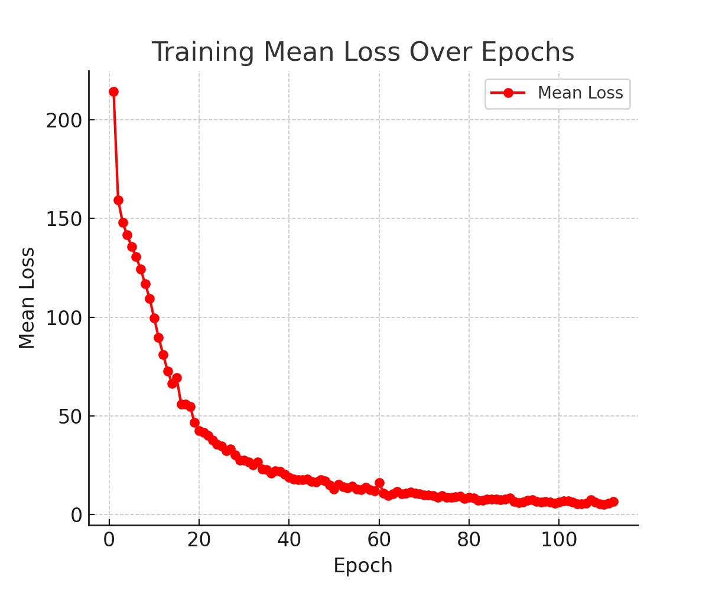
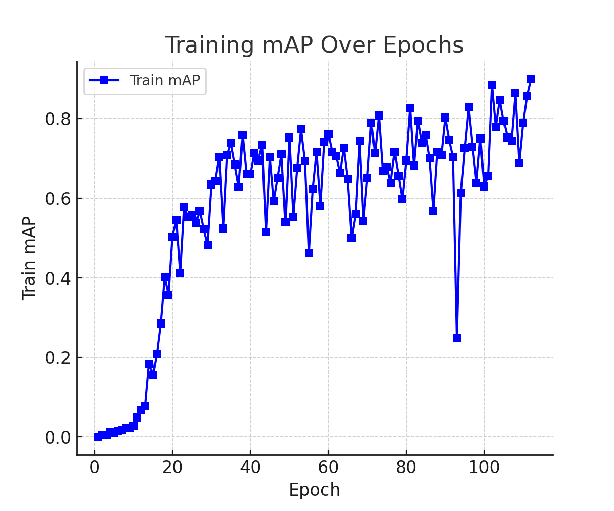

# YOLOv1: confidence, localization and the limits of a grid

MVA course project, revised by Nassim Arifette.

[Experiment protocol](docs/EXPERIMENT_PROTOCOL.md) · [Reproduction](docs/REPRODUCIBILITY.md) · [Primary-source reading](docs/LITERATURE.md)

This project implements a YOLOv1-style detector and asks how confidence
targets and data augmentation affect detection under a fixed evaluation
protocol. It also measures a structural limitation identified in the
[original paper](https://arxiv.org/abs/1506.02640): objects with nearby centers
can compete for the same grid cell.

**Current status:** the implementation and evaluation have been revised and
CPU protocol checks pass. There is **no measured held-out mAP for the revised
pipeline**. New training, the full Torch test suite and the GPU smoke test
remain to be run in an environment with PyTorch and VOC data. Historical
training curves cannot establish generalization or explain the cause of poor
performance.

## What changed

- Confidence learns the responsible box's detached IoU. The responsible box
  is selected by IoU; every other predictor receives the no-object penalty.
  An explicit `one` target is available as a controlled ablation.
- Width and height use whole-image units. Target shapes and indices follow
  the configured number of boxes and classes; the backbone supports a 7×7
  grid on 448px images.
- Inference keeps both box predictors and ranks detections by class score
  multiplied by box confidence. NMS is class-specific.
- Evaluation reads **every XML object**, including those dropped by the
  one-target-per-cell training encoder. Difficult objects are ignored during
  VOC matching, duplicate detections are false positives, and VOC2007 uses
  its interpolated 11-point AP. The integral AP option is named separately.
- Training uses `train`, selects checkpoints on `val`, and evaluates `test`
  with a separate command. Manifests, source hashes, settings, per-class AP,
  failures and resumable checkpoints are saved.
- Data preparation preserves images, annotations and official split files.
  Download checksums and extraction boundaries are checked. The old CSV
  conversion path is retired.

The existing backbone uses BatchNorm and a **496-unit** fully connected head,
where the original paper used a 4,096-unit head and classification pretraining.
This revision trains from scratch, uses SGD with warmup/cosine scheduling and
optional flips/color changes, and restores dropout at 0.5. It is a resource
constrained study, **not an exact reproduction of the paper's published mAP**.
These choices stay fixed in the planned confidence ablation.

## Run

From this directory in a Python environment with a CUDA-enabled Torch build:

```bash
python -m pip install -r requirements-test.txt
python -m pytest tests -q
python gpu_smoke.py
python download_voc.py --data-dir data
python train.py --voc-root data/VOCdevkit --out outputs/iou_aug_seed123
python evaluate.py --checkpoint outputs/iou_aug_seed123/best.pt --manifest data/manifests/test.json --voc-root data/VOCdevkit --out outputs/iou_aug_seed123_test
```

The download includes official VOC2007 train/val/test archives. It does not
merge validation into training. Evaluation has no augmentation. Its score
floor and NMS threshold are saved with every result; tune them on validation
only. A small subset can omit classes, so the metrics also report how many
classes have ground truth.

See the [reproduction guide](docs/REPRODUCIBILITY.md) for Colab, a one-epoch
pipeline check, exact resumption, output interpretation and pending validation.
The [experiment protocol](docs/EXPERIMENT_PROTOCOL.md) defines the comparisons
before any new test results are examined.

## Historical material

The [poster](Poster_YoloV1.png), [PDF](yolo.pdf) and figures remain historical
artifacts. They have not been rewritten to imply results from the new code.
The old plots are training diagnostics:

| Training loss | Historical training mAP |
|---|---|
|  |  |

The previous comparison videos and confidence plots across modern YOLO
versions are qualitative demonstrations. Uncalibrated confidence values do
not establish relative accuracy, and no controlled latency protocol was
preserved. The claim that YOLOv3 was the best model has therefore been removed.

## Files

| File | Role |
|---|---|
| `protocol.py`, `prepare_voc.py`, `preflight.py` | Frozen splits, full annotations and grid-collision audit |
| `dataset.py`, `model.py`, `loss.py` | Image/target processing, network and objective |
| `metrics.py`, `utils.py` | VOC AP, class-aware NMS and complete prediction decoding |
| `train.py`, `runtime.py`, `evaluate.py` | Training, recovery and held-out evaluation |
| `configs/voc2007.json` | Recorded experiment defaults |
| `gpu_smoke.py`, `tests/` | Synthetic execution check and invariants |

No dataset, model weights, credentials or claimed new benchmark results are
included in this repository.

## Standalone project site

Open [the site](site/index.html) directly, or serve it locally:

```bash
python export_site_assets.py
python -m http.server 8000 --directory site
```

The site explains IoU, class-specific NMS and grid collisions with interactive
synthetic geometry. It labels unmeasured experiments and historical figures
explicitly. All scripts, styles, documents and images are local to `site/`;
no parent repository, API, model download or external font is required.
Run `python export_site_assets.py` after editing the source documentation.
JavaScript geometry invariants can be checked with
`node --test tests/site_geometry.test.cjs`. Browser layout checks are separate
from those numerical assertions.
