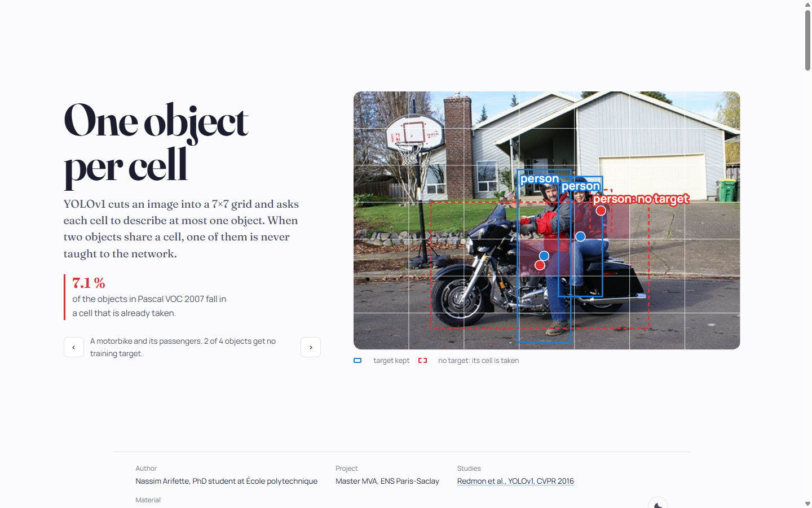

# One object per cell

**A from-scratch YOLOv1 on Pascal VOC 2007, rebuilt so its numbers can be trusted: what the 7×7 grid costs, and what the confidence score should learn.**

[**Open the interactive article →**](https://nassim-arifette.github.io/yolov1-object-detection/)

[](https://nassim-arifette.github.io/yolov1-object-detection/)

## What it measures

**The grid's blind spot.** YOLOv1 assigns each object to the one cell that contains its centre, and each cell describes at most one object. Over the official VOC 2007 train, validation and test lists, **1,745 of 24,640 non-difficult objects (7.1 %) land in a cell that is already taken** and never become a training target. 1,141 of 9,963 images are affected. The cost depends on the class: 15.8 % of bottles and 11.0 % of people, against 0.1 % of cats and no train at all. This audit runs on the annotations only; it is not an AP loss, and not a hard recall ceiling.

**What confidence should learn.** The paper trains each box's confidence towards its IoU with the object; a simpler control trains it towards 1. A frozen 2×2 protocol (confidence target × augmentation, three seeds each) compares them under identical conditions. **That training is in progress; no new mAP is reported yet.**

| Condition | Confidence target | Augmentation |
|---|---|---|
| A | constant 1 | none |
| B | detached responsible-box IoU | none |
| C | constant 1 | horizontal flip and colour changes |
| D | detached responsible-box IoU | horizontal flip and colour changes |

Effects of interest: B − A and D − C for the target, C − A and D − B for augmentation, all reported with seeds, including zero or negative ones. Full protocol: [`docs/EXPERIMENT_PROTOCOL.md`](docs/EXPERIMENT_PROTOCOL.md).

## What you can do on the site

| Figure | Try this |
| --- | --- |
| What a cell has to say | Hover any cell of a real VOC image and see the exact training target it receives. |
| The grid's blind spot | The per-class share of objects left without a target, by split. |
| What confidence should learn | Drag a predicted box against a real annotation and compare the two confidence targets. |
| Non-maximum suppression | Move the threshold and watch class-specific suppression. |

The grid encoder, IoU and NMS on the site are TypeScript ports of this repository's Python code, tested to drop exactly the same objects on all 4,952 test images.

## What was fixed in the implementation

- **Confidence** learns the responsible box's detached IoU; the responsible box is chosen by IoU and every other predictor gets the no-object penalty. A constant target is available as a controlled ablation.
- **Coordinates** follow the paper: centre offsets in the cell, width and height in image units.
- **Inference** keeps both boxes, ranks detections by class score × confidence, and applies class-specific NMS.
- **Evaluation** reads every XML object, including those the training encoder drops, ignores difficult objects as VOC does, counts duplicates as false positives, and uses VOC 2007's 11-point interpolated AP.
- **Data** keeps train, validation and test apart: training on `train`, checkpoints chosen on `val`, `test` evaluated once. Manifests, hashes, settings, per-class AP and resumable checkpoints are saved.

The network trains from scratch with BatchNorm and a 496-unit head instead of ImageNet pretraining and a 4,096-unit head. This is a resource-constrained study, **not an exact reproduction of the paper's published mAP**.

## Run it

```bash
python -m pip install -r requirements-test.txt
python -m pytest tests -q
python gpu_smoke.py
python download_voc.py --data-dir data          # verified VOC2007 archives, manifests, grid audit
python train.py --voc-root data/VOCdevkit --out outputs/iou_aug_seed123
python evaluate.py --checkpoint outputs/iou_aug_seed123/best.pt --manifest data/manifests/test.json --voc-root data/VOCdevkit --out outputs/iou_aug_seed123_test
```

Training needs a CUDA build of PyTorch. See [`docs/REPRODUCIBILITY.md`](docs/REPRODUCIBILITY.md) for Colab, a one-epoch pipeline check and exact resumption, and [`docs/LITERATURE.md`](docs/LITERATURE.md) for what the paper and the authors' code actually specify.

## Repository layout

| Path | Role |
|---|---|
| `protocol.py`, `prepare_voc.py`, `preflight.py` | Frozen splits, full annotations and the grid-collision audit |
| `dataset.py`, `model.py`, `loss.py` | Image and target processing, network and objective |
| `metrics.py`, `utils.py` | VOC AP, class-specific NMS and prediction decoding |
| `train.py`, `runtime.py`, `evaluate.py` | Training, recovery and held-out evaluation |
| `configs/voc2007.json` | Recorded experiment defaults |
| `gpu_smoke.py`, `tests/` | Synthetic execution check and invariants |
| `web/` | Source of the website (Vite + TypeScript, D3). See [`docs/SITE.md`](docs/SITE.md) |

No dataset, model weights or credentials are included.

## Historical material

The [poster](Poster_YoloV1.png), [report](yolo.pdf) and [figures](figures/) of the original course project are kept as artifacts. Their curves are training diagnostics from code that has since been fixed; they say nothing about generalisation. The comparison videos with newer YOLO versions are qualitative only, so the earlier claim that YOLOv3 was the best model has been removed.

Nassim Arifette, PhD student at École polytechnique. Master MVA, ENS Paris-Saclay.
